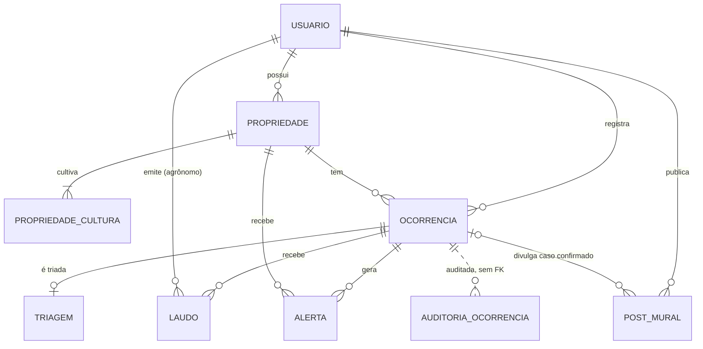
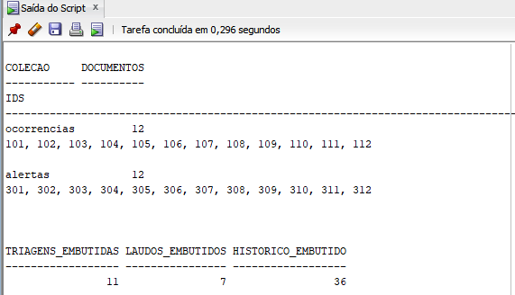
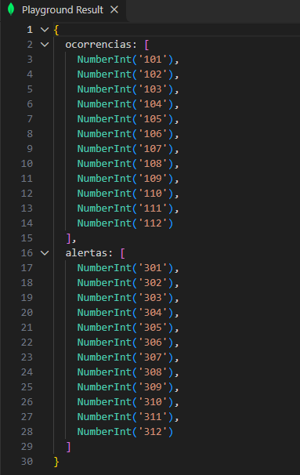
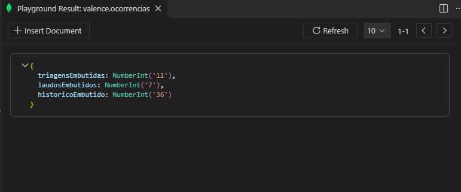
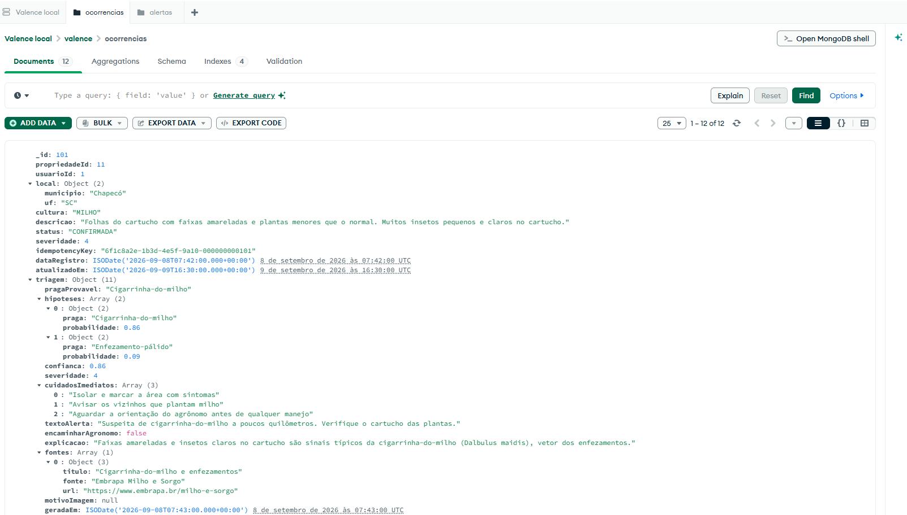
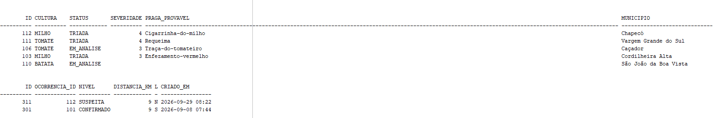
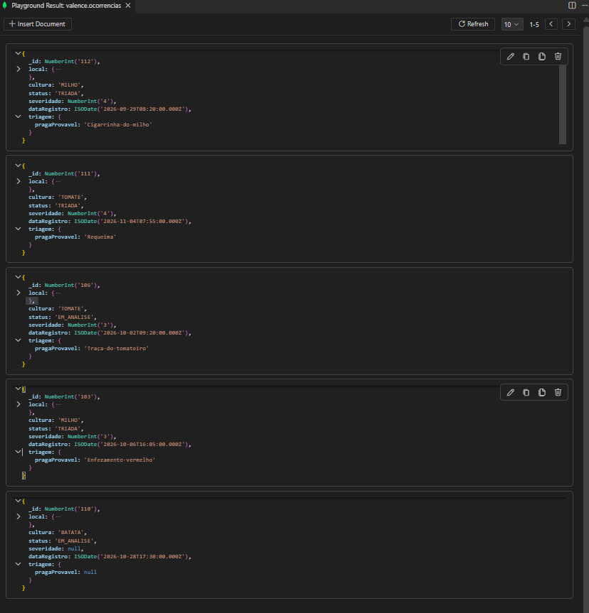
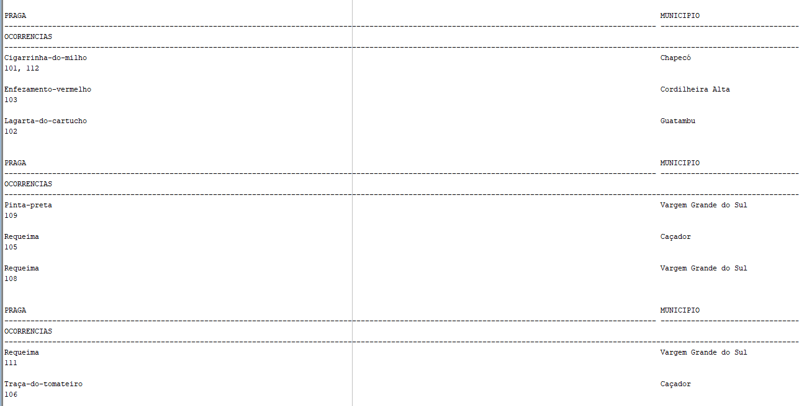
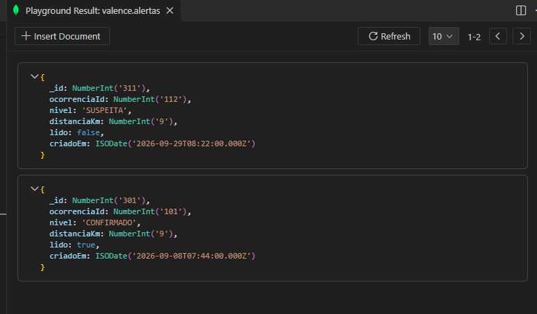

# Valence · Do Oracle ao MongoDB, dados a serviço do cidadão

Global Solution FIAP 2026/2 · Tema CitizenTech · Mastering Relational and Non-Relational Database

## Integrantes

| RM | Nome |
| --- | --- |
| 563620 | Henrique Martins |
| 562396 | Guilherme Macedo |
| 563405 | Pedro Henrique |

## O problema

Comunidades rurais isoladas descobrem pragas tarde, sem técnico por perto e sem um canal rápido entre vizinhos e poder público. Quando o dano aparece, a praga já se espalhou pelas lavouras próximas, e a perda chega ao produtor e ao consumidor, no preço e na oferta.

- A FAO estima que cerca de 40% da produção agrícola global é perdida para pragas.
- A Embrapa (2026) estima que a cigarrinha-do-milho causa prejuízo de US$ 6,5 bilhões por ano no Brasil, com perda média de 22,7% da produção entre 2020 e 2024.

## A solução

O Valence é uma rede pública e colaborativa de vigilância fitossanitária para pequenos produtores de milho, tomate e batata.

1. O produtor registra o dano na lavoura com foto e descrição.
2. A triagem automática aponta a praga provável e a severidade.
3. As propriedades vizinhas com a mesma cultura recebem um alerta de suspeita.
4. Um agrônomo da extensão rural confirma ou descarta o caso.
5. Os focos confirmados viram dados abertos e anonimizados para o poder público.

| Quem | Benefício |
| --- | --- |
| Agricultor familiar e pequeno produtor | Aviso precoce de pragas na vizinhança e acesso a um agrônomo |
| Agrônomos da extensão rural e defesa agropecuária | Casos estruturados, priorizados por severidade |
| Poder público e sociedade | Dados abertos para política pública |

### ODS

| ODS | Contribuição |
| --- | --- |
| 2 · Fome zero e agricultura sustentável | Reduz perdas de safra com detecção precoce |
| 9 · Indústria, inovação e infraestrutura | Leva dados ao campo com baixo custo |
| 10 · Redução das desigualdades | Dá ao pequeno produtor isolado acesso a técnico |
| 13 · Ação contra a mudança do clima | Monitora pragas que se espalham com o clima |

## O papel do banco de dados

- **Oracle:** guarda o modelo relacional do Valence e implementa as regras de negócio em PL/SQL: registro de ocorrência com idempotência, distância entre propriedades, emissão de alertas no raio, risco do município, transição de status e trilha de auditoria.
- **MongoDB:** representa parte dos mesmos dados (ocorrências e alertas) como documentos, com os mesmos identificadores do Oracle.
- **Transição:** não há integração automática entre os bancos. A correspondência é demonstrada pela carga com os mesmos IDs e pela comparação dos resultados das mesmas consultas nos dois modelos.

## Requisitos do PDF e onde estão

| Requisito | Entrega | Arquivos | Evidências |
| --- | --- | --- | --- |
| 01 Oracle: 2+ tabelas relacionadas, dados de teste, 2 blocos PL/SQL | 9 tabelas com PK, FK, CHECK e índices; 12 ocorrências de milho, tomate e batata; bloco com cursor explícito e bloco com repetição e decisão | `oracle/01_ddl.sql`, `03_dados.sql`, `04_blocos.sql` | 03, 05, 06, 09a, 09b |
| 02 2 funções e 2 procedimentos | `FN_DISTANCIA_KM`, `FN_NIVEL_RISCO`, `PRC_REGISTRAR_OCORRENCIA`, `PRC_EMITIR_ALERTAS_RAIO` | `oracle/05_funcoes_procedimentos.sql` | 10, 11, 12 |
| 03 2 gatilhos, 1 de auditoria | `TRG_VALIDA_SEVERIDADE`, `TRG_AUDIT_OCORRENCIA` (data, operação, valores antigo e novo) | `oracle/02_gatilhos.sql` | 04, 07, 08, 16 |
| 04 2 pacotes com testes | `PKG_ALERTA` e `PKG_OCORRENCIA` (specification e body); 48 testes automatizados | `oracle/06_pacotes.sql`, `07_testes.sql` | 13, 14, 15, 16, 17, `saida-07-testes.txt` |
| 05 MongoDB: database, 2 collections, 10+ documentos | Database `valence`, coleções `ocorrencias` e `alertas` com validação de esquema, 24 documentos | `mongodb/01_setup.mongodb.js`, `02_carga.mongodb.js` | 24, 25 |
| 06 Mapa, 3 consultas MongoDB (1 agregação) e comparação | Mapa relacional → documental nesta página; 2 `find` e 1 `aggregate` com resultado igual ao SQL | `mongodb/03_relatorios.mongodb.js`, `oracle/08_relatorios.sql` | 18 a 20, 26 a 30 |

## Estrutura do repositório

```
valence-database/
  oracle/
    00_executar_tudo.sql          executa os 8 scripts na ordem
    01_ddl.sql                    tabelas, sequências e índices
    02_gatilhos.sql               validação de severidade e auditoria
    03_dados.sql                  dados de teste
    04_blocos.sql                 2 blocos PL/SQL anônimos
    05_funcoes_procedimentos.sql  2 funções e 2 procedimentos
    06_pacotes.sql                PKG_ALERTA e PKG_OCORRENCIA
    07_testes.sql                 48 testes com sucesso e erro
    08_relatorios.sql             consultas SQL equivalentes às do MongoDB
  mongodb/
    01_setup.mongodb.js           database, coleções, validação e índices
    02_carga.mongodb.js           12 ocorrências e 12 alertas
    03_relatorios.mongodb.js      correspondência e 3 relatórios
  evidencias/                     prints e saídas da execução
  README.md
```

## Como executar

### Pré-requisitos

- **Oracle:** SQL Developer conectado a um schema Oracle 12c ou superior. Os scripts criam e apagam somente os objetos do Valence, pelo nome exato; outras tabelas do schema não são alteradas.
- **MongoDB:** servidor local (`mongodb://localhost:27017`) ou Atlas, e o VS Code com a extensão **MongoDB for VS Code**. O MongoDB Compass é opcional, para ver os documentos.

### Oracle

**Tudo de uma vez:** no SQL Developer, abra `oracle/00_executar_tudo.sql` pelo menu Arquivo > Abrir e execute com **F5** (Executar Script). Ele roda os 8 arquivos na ordem, do zero, e pode ser executado de novo quantas vezes for preciso.

**Arquivo por arquivo**, sempre nesta ordem e com F5:

| Ordem | Arquivo | Resultado esperado |
| --- | --- | --- |
| 1 | `01_ddl.sql` | 9 tabelas, 3 sequências e 7 índices criados |
| 2 | `02_gatilhos.sql` | 2 gatilhos `VALID` |
| 3 | `03_dados.sql` | 10 usuários, 10 propriedades, 12 ocorrências, 11 triagens, 7 laudos, 12 alertas, 4 posts e 36 linhas de auditoria |
| 4 | `04_blocos.sql` | 12 ocorrências em 6 municípios; risco das propriedades: 4 ALTO, 3 MEDIO, 3 BAIXO |
| 5 | `05_funcoes_procedimentos.sql` | 2 funções e 2 procedimentos `VALID` |
| 6 | `06_pacotes.sql` | 2 pacotes e 2 bodies `VALID` |
| 7 | `07_testes.sql` | 48 testes aprovados, 0 com falha; base intacta (12, 12, 36) |
| 8 | `08_relatorios.sql` | Correspondência e os 3 relatórios |

Os gatilhos são criados antes dos dados para a própria carga gerar a trilha de auditoria. Os testes terminam com `ROLLBACK` em cada grupo, então a base continua igual à carga.

### MongoDB

No VS Code, abra a pasta do repositório, conecte a extensão em `mongodb://localhost:27017`, abra cada arquivo e clique no botão **▶** (Run). A extensão `.mongodb.js` é a do Playground, forma de execução usada em aula.

| Ordem | Arquivo | Resultado esperado |
| --- | --- | --- |
| 1 | `01_setup.mongodb.js` | Database `valence`, coleções `alertas` e `ocorrencias` com validação e índices |
| 2 | `02_carga.mongodb.js` | 12 ocorrências, 12 alertas (24 documentos), 11 triagens, 7 laudos e 36 itens de histórico |
| 3 | `03_relatorios.mongodb.js` | O ▶ mostra o último relatório (agregação). Para cada um dos outros, selecione as linhas do bloco, do `use('valence');` até o `;` final, e use botão direito > **MongoDB: Run Selected Lines From Playground** |

Os dois primeiros podem ser executados de novo: o `01` recria as coleções e o `02` limpa com `deleteMany({})` antes de inserir.

## Modelo relacional (Oracle)



| Tabela | Conteúdo | Regras no banco |
| --- | --- | --- |
| `USUARIO` | Produtores, agrônomos e gestor | Papel em PRODUTOR, AGRONOMO ou GESTOR; e-mail único; UF válida |
| `PROPRIEDADE` | Lavouras com coordenadas | Latitude de -90 a 90, longitude de -180 a 180, área maior que zero |
| `PROPRIEDADE_CULTURA` | Culturas de cada propriedade | MILHO, TOMATE ou BATATA; chave (propriedade, cultura) |
| `OCORRENCIA` | Dano registrado pelo produtor | Status do fluxo do Valence; descrição de 10 a 1000 caracteres; chave de idempotência única por usuário |
| `TRIAGEM` | Resultado da triagem automática (1:1) | Hipóteses, cuidados e fontes em JSON validado; confiança de 0 a 1 |
| `LAUDO` | Decisão do agrônomo | CONFIRMADA exige praga; parecer de 20 a 2000 caracteres |
| `ALERTA` | Aviso para propriedade vizinha | Nível SUSPEITA, CONFIRMADO ou ENCERRADO; distância de pelo menos 1 km; um alerta por ocorrência e propriedade |
| `POST_MURAL` | Mural da região | Status ATIVO, OCULTO ou REMOVIDO |
| `AUDITORIA_OCORRENCIA` | Trilha de auditoria | Sem FK, para a trilha sobreviver à exclusão da ocorrência |

**Dados de teste:** milho no oeste de Santa Catarina (cigarrinha-do-milho, lagarta-do-cartucho, enfezamento e um caso descartado), tomate em Caçador/SC (requeima, traça) e batata em Vargem Grande do Sul/SP (requeima, pinta-preta e uma foto recusada). As distâncias dos alertas foram calculadas pela fórmula de Haversine com raio de 10 km. Nomes, e-mails e telefones são fictícios.

## Objetos PL/SQL

| Objeto | Tipo | Regra real do Valence |
| --- | --- | --- |
| Bloco 1 | Cursor explícito (`OPEN`, `FETCH`, `CLOSE`) | Lista as ocorrências por município, com subtotal e total de confirmadas |
| Bloco 2 | `FOR ... LOOP` e `IF / ELSIF` | Classifica cada propriedade em ALTO, MEDIO ou BAIXO pelos alertas recebidos |
| `FN_DISTANCIA_KM` | Função | Distância entre duas coordenadas pela fórmula de Haversine |
| `FN_NIVEL_RISCO` | Função | Risco do município pela severidade e pelo número de ocorrências ativas; usada dentro de `SELECT` |
| `PRC_REGISTRAR_OCORRENCIA` | Procedimento | Só produtor, só na própria propriedade, só cultura plantada nela, descrição válida e idempotência pela chave UUID |
| `PRC_EMITIR_ALERTAS_RAIO` | Procedimento com cursor parametrizado | Cria alertas para as propriedades da mesma cultura dentro do raio, sem repetir; raio inclusivo |
| `TRG_VALIDA_SEVERIDADE` | Gatilho BEFORE | Severidade de 1 a 5 e sem severidade em ocorrência RECEBIDA |
| `TRG_AUDIT_OCORRENCIA` | Gatilho AFTER | Grava data, operação, usuário do banco e status e severidade antigos e novos em INSERT, UPDATE e DELETE |
| `PKG_ALERTA` | Pacote | Distância, emissão de alertas e mudança de nível; constante pública `C_RAIO_PADRAO_KM` e exceção pública `E_STATUS_SEM_ALERTA` |
| `PKG_OCORRENCIA` | Pacote | Risco, registro e transição de status; função privada `FN_TRANSICAO_PERMITIDA` e exceção pública `E_TRANSICAO_INVALIDA`; chama o `PKG_ALERTA` como a API Java faz após a triagem e o laudo |

As 4 rotinas do requisito 02 existem avulsas (`05`) e dentro dos pacotes (`06`). O enunciado avalia os dois requisitos separadamente; os pacotes são a versão usada entre si e nos testes.

### Testes (`07_testes.sql`)

| Grupo | O que prova | Casos |
| --- | --- | --- |
| A | Rotinas avulsas: resultados certos e todos os erros de regra (-20010 a -20042) | 25 |
| B | Pacotes: fluxo de status com efeito nos alertas e exceções nomeadas | 16 |
| C | Gatilhos: validação e auditoria de INSERT, UPDATE e DELETE | 7 |

Resultado: **48 aprovados, 0 com falha** ([saída completa](evidencias/saida-07-testes.txt)).

## Mapa relacional → documental

O MongoDB recebe a parte dos dados que o Valence lê como um caso completo (a ocorrência) e a parte que cada produtor consulta separadamente (os alertas). A escolha entre embutir e referenciar segue os critérios vistos em aula: **embutir** quando os dados são lidos juntos e a operação deve ser atômica no documento, cuidando do crescimento; **referenciar** quando a entidade é compartilhada, cresce sem limite ou é consultada sozinha.

### Tabela a tabela

| Oracle | MongoDB | Estratégia | Por quê |
| --- | --- | --- | --- |
| `OCORRENCIA` | coleção `ocorrencias` | Documento principal, `_id` igual ao `ID` | É a unidade que o produtor e o agrônomo abrem |
| `TRIAGEM` (1:1) | `ocorrencias.triagem` | **Embutido** | Sempre lida junto da ocorrência; existe no máximo uma por caso |
| `LAUDO` (1:N, poucos) | `ocorrencias.laudos[]` | **Embutido** | Poucos por caso (normalmente um; dois quando o agrônomo pede mais informações) e lidos junto da ocorrência |
| `AUDITORIA_OCORRENCIA` | `ocorrencias.historicoStatus[]` | **Embutido** | O histórico de status é parte da leitura do caso e cresce pouco (poucas mudanças de status por caso) |
| `PROPRIEDADE` | `ocorrencias.propriedadeId` e cópia de `local.municipio` e `local.uf` | **Referência** com cópia de 2 campos | A propriedade é compartilhada por várias ocorrências; município e UF são copiados para o relatório por região não precisar de outra coleção |
| `USUARIO` | `ocorrencias.usuarioId`, `laudos[].agronomoId` | **Referência** só pelo ID | Entidade compartilhada e com dados pessoais, que não vão para o MongoDB |
| `ALERTA` | coleção `alertas` com `ocorrenciaId` e `propriedadeId` | **Referência** | Uma ocorrência pode gerar muitos alertas, cada produtor consulta os alertas da **sua** propriedade, e o alerta muda sozinho (lido, nível). Embutido, faria a ocorrência crescer e obrigaria a abrir todas as ocorrências para achar os alertas de uma propriedade |
| `PROPRIEDADE_CULTURA`, `POST_MURAL`, `USUARIO` (dados) | não migradas | | O PDF pede parte dos mesmos dados; essas tabelas não entram nos relatórios e o usuário tem dados pessoais |

### Campo a campo: o que muda de formato

| Oracle | MongoDB | Observação |
| --- | --- | --- |
| `ID NUMBER` | `_id` número | Mesmo valor, prova da correspondência |
| `TIMESTAMP` | `Date` (ISODate) | Mesmo horário |
| `CHAR(1)` `'S'`/`'N'` (`LIDO`, `ENCAMINHAR_AGRONOMO`) | `true`/`false` | O documento tem booleano nativo |
| Texto JSON validado com `IS JSON` (hipóteses, cuidados, fontes) | Arrays de subdocumentos | No MongoDB a lista é estrutura de verdade e pode ser consultada |
| CHECK (status, cultura, nível, severidade) | Validação `$jsonSchema` com `enum`, `minimum` e `maximum` | Esquema flexível com validação, como visto em aula |
| UNIQUE (usuário + chave de idempotência; ocorrência + propriedade no alerta) | Índices únicos | Mesmas garantias |
| Linha de `AUDITORIA_OCORRENCIA` | Item de `historicoStatus` | Mesma operação, status e severidade antigos e novos. O campo `em` traz a data de negócio da mudança; a `DATA_OPERACAO` do Oracle é o momento em que o script rodou e não é copiada |

### Correspondência entre os bancos

| | Oracle | MongoDB |
| --- | --- | --- |
| Ocorrências | 12 linhas, IDs 101 a 112 | 12 documentos, `_id` 101 a 112 |
| Alertas | 12 linhas, IDs 301 a 312 | 12 documentos, `_id` 301 a 312 |
| Triagens | 11 linhas em `TRIAGEM` | 11 subdocumentos `triagem` |
| Laudos | 7 linhas em `LAUDO` | 7 itens em `laudos` |
| Auditoria | 36 linhas em `AUDITORIA_OCORRENCIA` | 36 itens em `historicoStatus` |






**No Oracle, montar um caso completo exige juntar 5 tabelas** (ocorrência, propriedade, triagem, laudo e auditoria). **No MongoDB, uma única leitura do documento traz tudo.** Em troca, uma mudança no nome do município teria de ser repetida nas ocorrências, e os alertas precisam de uma segunda consulta para trazer dados da ocorrência.

## Relatórios e comparação

Cada relatório responde uma pergunta real do Valence e foi escrito nos dois bancos. Os resultados são iguais linha a linha.

### Relatório 1 · Fila de análise do agrônomo

Ocorrências TRIADA e EM_ANALISE, da maior severidade para a menor e, no empate, da mais antiga para a mais nova (mesma ordem da API).

- **SQL:** `JOIN` com PROPRIEDADE e TRIAGEM, `WHERE STATUS IN (...)`, `ORDER BY SEVERIDADE DESC NULLS LAST, DATA_REGISTRO`.
- **MongoDB:** `find({ status: { $in: ['TRIADA', 'EM_ANALISE'] } })` com projeção e `sort({ severidade: -1, dataRegistro: 1 })`. Praga e município já estão no documento.

| Ocorrência | Cultura | Status | Severidade | Praga provável | Município |
| --- | --- | --- | --- | --- | --- |
| 112 | MILHO | TRIADA | 4 | Cigarrinha-do-milho | Chapecó/SC |
| 111 | TOMATE | TRIADA | 4 | Requeima | Vargem Grande do Sul/SP |
| 106 | TOMATE | EM_ANALISE | 3 | Traça-do-tomateiro | Caçador/SC |
| 103 | MILHO | TRIADA | 3 | Enfezamento-vermelho | Cordilheira Alta/SC |
| 110 | BATATA | EM_ANALISE | sem | sem (foto recusada) | São João da Boa Vista/SP |




### Relatório 2 · Alertas ativos do Sítio Dalla Costa (propriedade 12)

- **SQL:** `WHERE PROPRIEDADE_ID = 12 AND NIVEL <> 'ENCERRADO' ORDER BY CRIADO_EM DESC`.
- **MongoDB:** `find({ propriedadeId: 12, nivel: { $ne: 'ENCERRADO' } }).sort({ criadoEm: -1 })`.

| Alerta | Ocorrência | Nível | Distância | Lido |
| --- | --- | --- | --- | --- |
| 311 | 112 | SUSPEITA | 9 km | não |
| 301 | 101 | CONFIRMADO | 9 km | sim |

O alerta 305 também é da propriedade 12, mas está ENCERRADO (a ocorrência 104 foi descartada) e fica de fora nos dois bancos.




### Relatório 3 · Ocorrências por praga, município e mês (agregação)

Mapa de pragas para o poder público. A praga é a confirmada pelo laudo ou, sem laudo de confirmação, a provável da triagem. Ocorrências descartadas e sem praga ficam de fora.

- **SQL:** `NVL(L.PRAGA_CONFIRMADA, T.PRAGA_PROVAVEL)`, `GROUP BY` praga, município, UF e `TO_CHAR(DATA_REGISTRO, 'YYYY-MM')`, `COUNT`, `MAX` e `LISTAGG`.
- **MongoDB:** `aggregate` com `$match`, `$addFields` (praga confirmada com `$filter` e `$map` sobre `laudos`, senão `triagem.pragaProvavel`), `$group` com `$dateToString`, `$sum`, `$max` e `$push`, `$project` e `$sort`.

| Praga | Município | Mês | Total | Maior severidade | Ocorrências |
| --- | --- | --- | --- | --- | --- |
| Cigarrinha-do-milho | Chapecó/SC | 2026-09 | **2** | 4 | 101, 112 |
| Enfezamento-vermelho | Cordilheira Alta/SC | 2026-10 | 1 | 3 | 103 |
| Lagarta-do-cartucho | Guatambu/SC | 2026-09 | 1 | 3 | 102 |
| Pinta-preta | Vargem Grande do Sul/SP | 2026-10 | 1 | 3 | 109 |
| Requeima | Caçador/SC | 2026-09 | 1 | 5 | 105 |
| Requeima | Vargem Grande do Sul/SP | 2026-09 | 1 | 4 | 108 |
| Requeima | Vargem Grande do Sul/SP | 2026-11 | 1 | 4 | 111 |
| Traça-do-tomateiro | Caçador/SC | 2026-10 | 1 | 3 | 106 |

Oracle: 8 linhas ([saída completa](evidencias/saida-00-executar-tudo.txt)). MongoDB: 8 documentos.


### Resumo da comparação

| Relatório | Oracle | MongoDB | Resultado |
| --- | --- | --- | --- |
| Correspondência | 12 + 12 registros; 11, 7 e 36 filhos | 12 + 12 documentos; 11, 7 e 36 subdocumentos | Igual |
| 1 · Fila de análise | 5 linhas | 5 documentos, mesma ordem | Igual |
| 2 · Alertas da propriedade 12 | 2 linhas | 2 documentos | Igual |
| 3 · Praga, município e mês | 8 grupos | 8 grupos | Igual |

## Evidências

| # | Arquivo | O que mostra |
| --- | --- | --- |
| 03 | [03-oracle-ddl-objetos.png](evidencias/03-oracle-ddl-objetos.png), [03b-1](evidencias/03b-oracle-ddl-restricoes1.png), [03b-2](evidencias/03b-oracle-ddl-restricoes2.png) | 9 tabelas, 3 sequências e restrições por tabela |
| 04 | [04-oracle-gatilhos-validos.png](evidencias/04-oracle-gatilhos-validos.png) | Gatilhos compilados e configuração |
| 05 | [05-oracle-carga-contagem.png](evidencias/05-oracle-carga-contagem.png) | Contagem da carga |
| 06 | [06-oracle-relacionamentos.png](evidencias/06-oracle-relacionamentos.png) | Junção das tabelas relacionadas |
| 07 | [07-oracle-auditoria.png](evidencias/07-oracle-auditoria.png) | Trilha de auditoria da ocorrência 101 |
| 08 | [08-oracle-gatilho-erro.png](evidencias/08-oracle-gatilho-erro.png) | Gatilho recusando severidade 7 (ORA-20001) |
| 09 | [09a-oracle-bloco-cursor.png](evidencias/09a-oracle-bloco-cursor.png), [09b-oracle-bloco-risco.png](evidencias/09b-oracle-bloco-risco.png) | Os 2 blocos PL/SQL |
| 10 | [10-oracle-funcoes-em-grade.png](evidencias/10-oracle-funcoes-em-grade.png), [1](evidencias/10-oracle-funcoes1.png), [2](evidencias/10-oracle-funcoes2.png), [3](evidencias/10-oracle-funcoes3.png), [4](evidencias/10-oracle-funcoes4.png) | Funções compiladas, resultados e caso de erro |
| 11 | [11-oracle-registrar-ocorrencia.png](evidencias/11-oracle-registrar-ocorrencia.png) | Registro e idempotência |
| 12 | [12-oracle-emitir-alertas1.png](evidencias/12-oracle-emitir-alertas1.png), [12-oracle-emitir-alertas2.png](evidencias/12-oracle-emitir-alertas2.png) | Emissão de alertas no raio |
| 13 | [13-oracle-pacotes-validos.png](evidencias/13-oracle-pacotes-validos.png) | Specification e body dos 2 pacotes `VALID` |
| 14 | [14-oracle-pacote-fluxo.png](evidencias/14-oracle-pacote-fluxo.png) | Fluxo de status pelo pacote |
| 15 a 17 | [15-1](evidencias/15-oracle-testes-inicio1.png), [15-2](evidencias/15-oracle-testes-inicio2.png), [16](evidencias/16-oracle-testes-gatilhos.png), [17](evidencias/17-oracle-testes-resumo.png) | Bateria de testes e resumo |
| 18 a 20 | [18](evidencias/18-oracle-correspondencia.png), [19](evidencias/19-oracle-relatorio1.png), [20](evidencias/20-oracle-relatorio2.png) | Correspondência e relatórios no Oracle |
| 24 | [24-mongodb-carga.png](evidencias/24-mongodb-carga.png) | Carga de 24 documentos |
| 25 | [25-mongodb-compass-documento.png](evidencias/25-mongodb-compass-documento.png), [25-1](evidencias/25-mongodb-compass-documento1.png) | Documento com triagem, laudos e histórico embutidos |
| 26 a 30 | [26](evidencias/26-mongodb-correspondencia.png), [27](evidencias/27-mongodb-relatorio1.png), [28](evidencias/28-mongodb-relatorio2.png), [29](evidencias/29-mongodb-relatorio3.png), [30](evidencias/30-mongodb-subdocumentos.png) | Correspondência e relatórios no MongoDB |
| Saídas | [saida-00-executar-tudo.txt](evidencias/saida-00-executar-tudo.txt), [saida-07-testes.txt](evidencias/saida-07-testes.txt) | Execução completa do Oracle e bateria de testes |

## Decisões técnicas

- **Limpeza segura:** o `01_ddl.sql` só apaga tabelas e sequências cujo nome está na lista do Valence, consultando `USER_TABLES` e `USER_SEQUENCES`. Tabelas de outros sistemas no mesmo schema nunca são tocadas, e o script roda do zero sem erro.
- **Sequências com prefixo `SEQ_VALENCE_`** começando em 1001, acima dos IDs fixos da carga.
- **Gatilhos antes dos dados:** o histórico de cada ocorrência nasce da auditoria real, não de linhas inseridas à mão.
- **Sem COMMIT dentro dos procedimentos:** quem chama controla a transação, o que permite testar e desfazer com `ROLLBACK`.
- **Exceções personalizadas** em todas as rotinas, convertidas em `RAISE_APPLICATION_ERROR` com códigos por objeto.
- **Nenhum dado pessoal no MongoDB:** sem nome, e-mail, telefone ou coordenada; o produtor aparece só pelo `usuarioId`. Os alertas guardam a distância arredondada, nunca a localização do vizinho.

## Uso de IA generativa

| Ferramenta | Uso |
| --- | --- |
| Claude (Anthropic) | Planejamento das etapas, revisão dos scripts SQL, PL/SQL e MongoDB, explicação de mensagens de erro do Oracle e do MongoDB, sugestão de cenários de dados de teste e revisão do texto deste README |

Todo script foi revisado, executado e entendido pelo integrante responsável antes da entrega. As decisões de modelagem e de regra de negócio seguem o modelo de dados do Valence e o material das aulas da disciplina.
